<!-- ============================================================
     README de perfil — github.com/Carlo-Morales
     Va en el repositorio público "Carlo-Morales" (mismo nombre que el usuario)
     ============================================================ -->

  

  
  
  
  

## 👋 ¡Hola! Soy Ramsés

Estudio **Ingeniería en Computación Inteligente** en la Universidad Autónoma de Aguascalientes. Me gusta entender a fondo cómo funciona un algoritmo y después llevarlo a código que resuelva un problema concreto.

- 🎓 Voy en **3.er semestre** de la carrera.
- 🧩 Mi fuerte son los **algoritmos y la programación competitiva**: entreno en Codeforces y participé en el **ICPC Gran Premio de México 2026**.
- 👨‍🏫 En el **Club de Programación Competitiva Gallos** compito, doy clases de algoritmos, armo problemsets para principiantes y hago coaching a equipos.
- 🌱 Ahora estoy aprendiendo **POO y backend con Python** y **arquitectura MVP** con Swift y SwiftUI.
- 📐 Diseño antes de programar: primero el diagrama de clases **UML**, luego el código.
- 💬 Pregúntame sobre grafos, DFS, backtracking, búsqueda binaria o programación dinámica.
- ⚡ Dato curioso: me encantan técnicas como **Reed–Solomon** y los **códigos de Huffman** (el árbol de arriba es uno 😉).

## 🧰 Tecnologías

<table>
  <tr>
    <td><b>Lenguaje principal</b></td>
    <td>
      
    </td>
  </tr>
  <tr>
    <td><b>En formación</b></td>
    <td>
      
      
      
    </td>
  </tr>
  <tr>
    <td><b>También he usado</b></td>
    <td>
      
      
      
      
      
      
    </td>
  </tr>
  <tr>
    <td><b>Herramientas y métodos</b></td>
    <td>
      
      
      
      
    </td>
  </tr>
</table>

## 🚀 Proyectos

<!-- 🔗 Cuando subas cada repo, convierte el título en enlace, por ejemplo:
     <h3><a href="https://github.com/Carlo-Morales/NOMBRE_DEL_REPO">🧭 Laberinto inteligente</a></h3>
     Y actualiza la etiqueta de estado si ya está terminado. -->

<table>
  <tr>
    <td width="50%" valign="top">
      <h3>🧭 Laberinto inteligente</h3>
      
      
      
      
Juego de laberinto generado aleatoriamente que la máquina resuelve con <b>DFS</b>. Proyecto de Inteligencia Artificial, organizado en módulos de generación, búsqueda y renderizado.

      
    </td>
    <td width="50%" valign="top">
      <h3>👑 Problema de las 8 reinas</h3>
      
      
      
      
Interfaz que dibuja el tablero y muestra las soluciones encontradas con <b>backtracking</b>. Mi primera UI en Python, con arquitectura MVP.

      
    </td>
  </tr>
  <tr>
    <td width="50%" valign="top">
      <h3>🗜️ Compresor con Huffman</h3>
      
      
Compresor de texto que calcula la frecuencia de cada símbolo y construye su <b>árbol de Huffman</b> para generar los códigos. Objetivo: comprimir archivos <code>.txt</code>.

      
    </td>
    <td width="50%" valign="top">
      <h3>🔳 Generador de códigos QR</h3>
      
      
Proyecto escolar de mis primeros semestres: genera códigos QR desde cero en C++.

      
    </td>
  </tr>
  <tr>
    <td width="50%" valign="top">
      <h3>🎒 Inventario para videojuego</h3>
      
      
      
      
App que muestra los objetos y herramientas de un videojuego como un inventario. La uso para aprender arquitectura <b>MVP</b>, diseñándola antes en <b>UML</b>.

      
    </td>
    <td width="50%" valign="top">
      <h3>🛸 Space Battle</h3>
      
      
      
Shooter espacial 2D. Con él aprendí Singleton, corrutinas, el New Input System y colisiones 2D, y probé builds para WebGL y Windows.

      
    </td>
  </tr>
</table>

## 🏆 Programación competitiva

<table>
  <tr>
    <td width="50%" valign="top">
      <h3>⚔️ Compito</h3>
      <ul>
        <li>Participé en el <b>ICPC Gran Premio de México 2026</b>, mi primera competencia ICPC.</li>
        <li>Entreno resolviendo problemas en <b>Codeforces</b>.</li>
        <li>Mantengo un acordeón en C++ con DP, búsqueda binaria, grafos y estructuras de datos.</li>
      </ul>
      <!-- Agrega tu perfil de Codeforces:
      
      -->
    </td>
    <td width="50%" valign="top">
      <h3>🐓 Enseño</h3>
      <ul>
        <li>Doy clases de algoritmos en el <b>CPC Gallos</b> de la UAA.</li>
        <li>Diseño problemsets para estudiantes que empiezan.</li>
        <li>Hago coaching a algunos equipos y ayudo a resolver dudas.</li>
      </ul>
    </td>
  </tr>
</table>

## 📜 Certificaciones

  
  

  
<b>🎯 Metas para lo que queda de 2026</b>

   
  <ul>
    <li>Terminar mi formación en POO y backend con Python.</li>
    <li>Presentar una certificación de POO (en preparación).</li>
    <li>Seguir construyendo la app de Swift para dominar MVP.</li>
    <li>Subir de nivel en programación competitiva.</li>
  </ul>

## 🐍 Mis contribuciones

<!-- Esta animación la genera el workflow .github/workflows/snake.yml.
     Aparece después de la primera ejecución (pestaña Actions → "Generar serpiente" → Run workflow). -->

  <picture>
    <source media="(prefers-color-scheme: dark)" srcset="https://raw.githubusercontent.com/Carlo-Morales/Carlo-Morales/output/github-snake-dark.svg">
    <source media="(prefers-color-scheme: light)" srcset="https://raw.githubusercontent.com/Carlo-Morales/Carlo-Morales/output/github-snake.svg">
    
  </picture>

## 📫 Contacto

<!-- Agrega tus enlaces cuando quieras, por ejemplo:

-->

¿Quieres hablar de algoritmos, armar equipo para un concurso o colaborar en un proyecto? Abre un issue en cualquiera de mis repos o escríbeme.

---

  <i>Gracias por pasar por aquí</i> 🐓 
  Aguascalientes, México · Graduación estimada: julio de 2030

